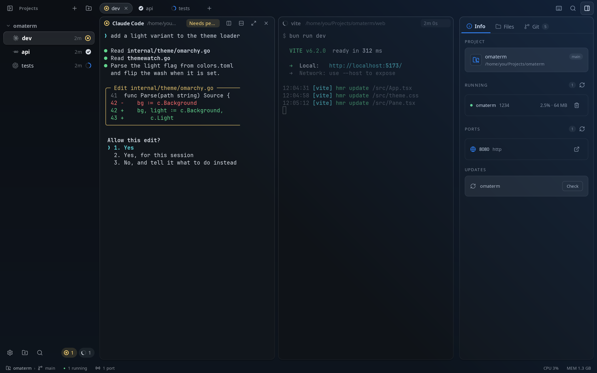
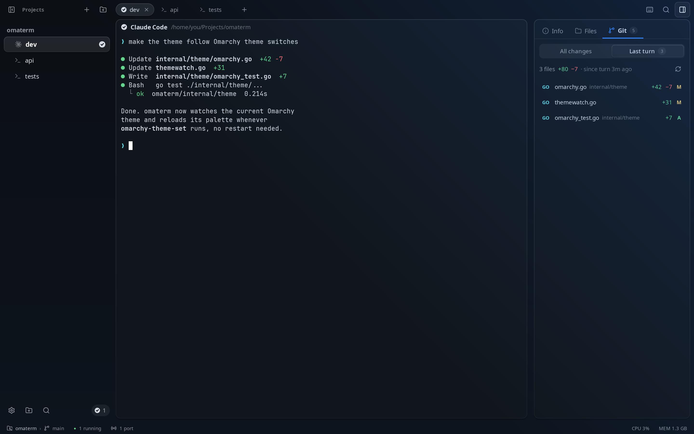
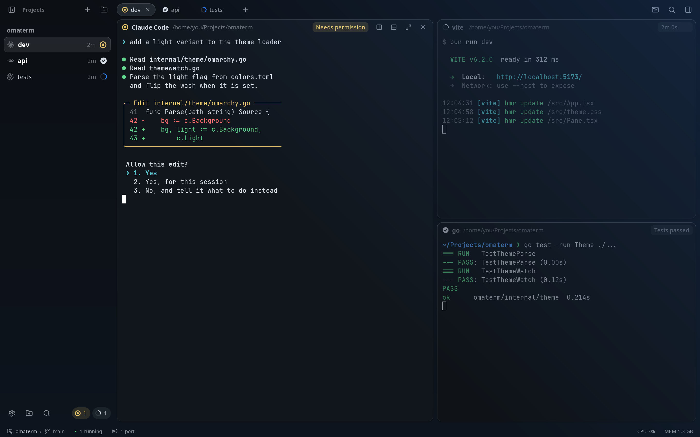
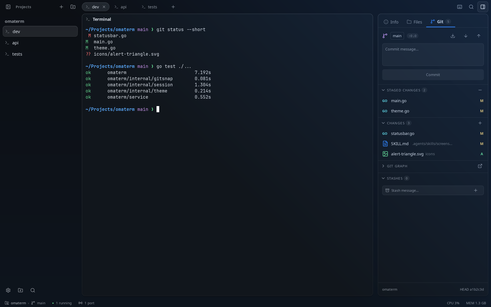
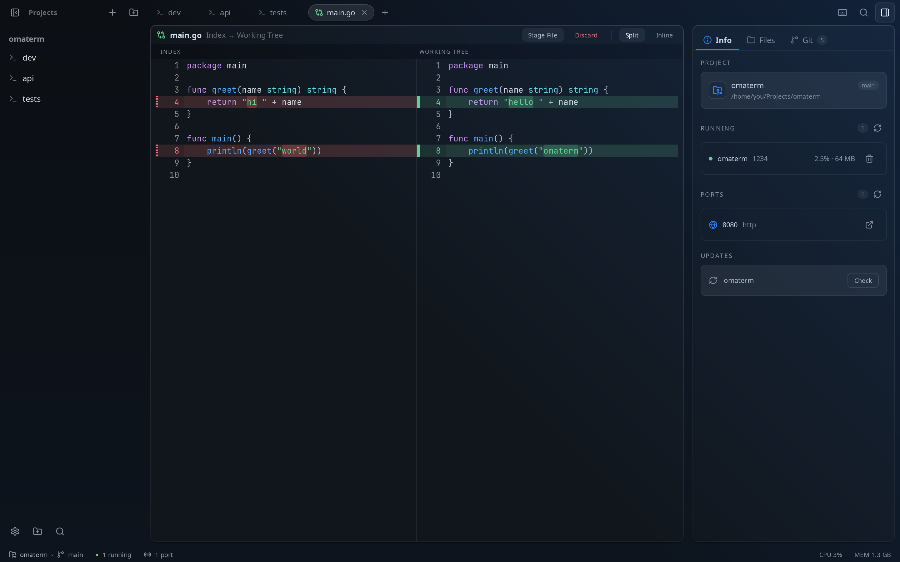
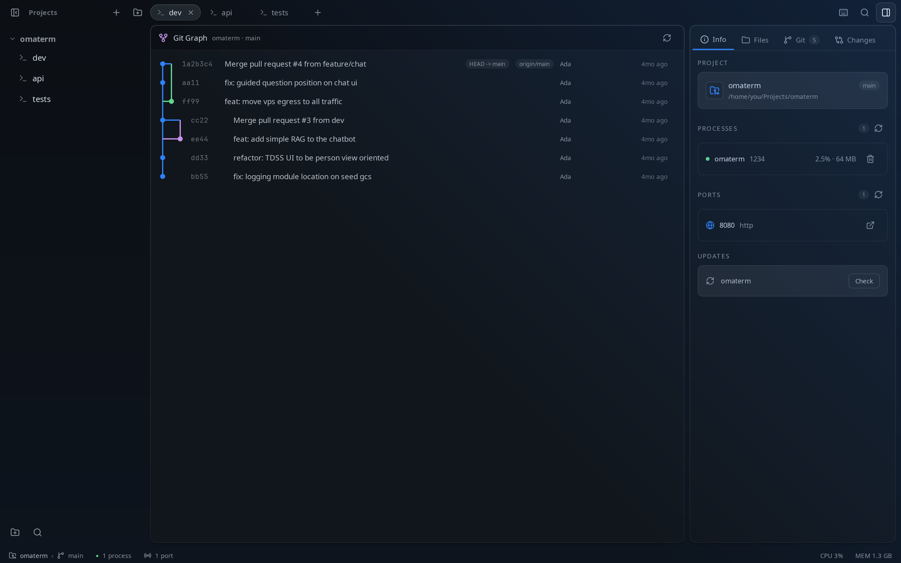
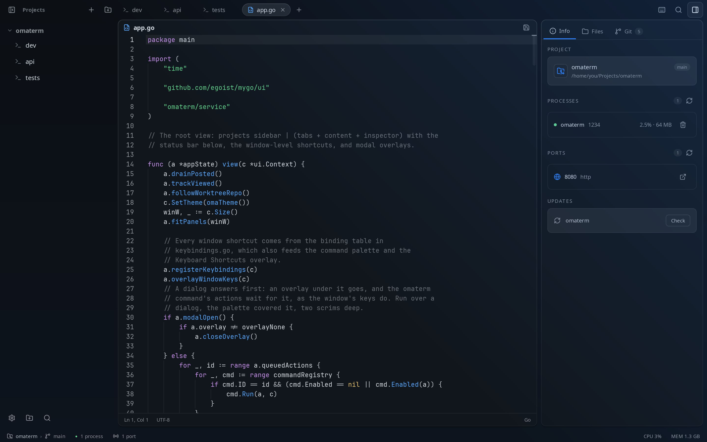
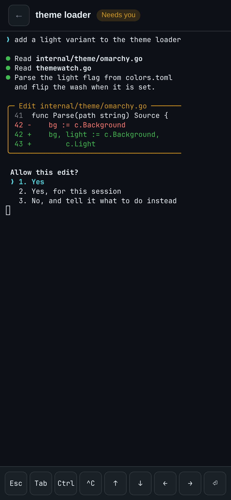
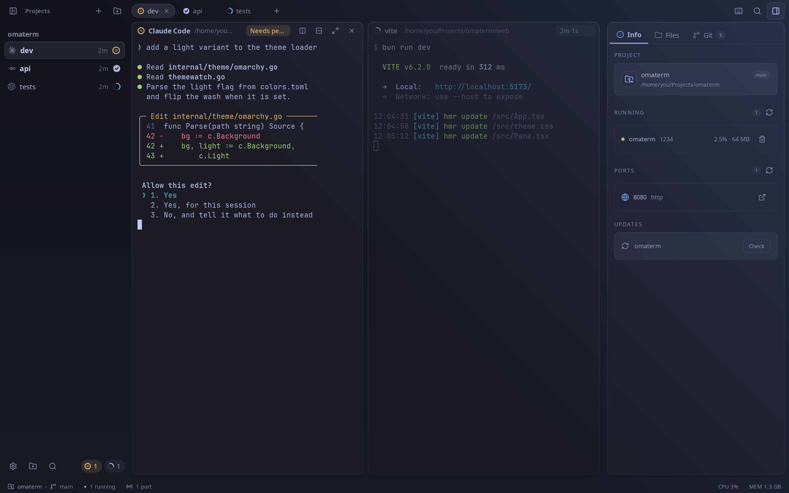
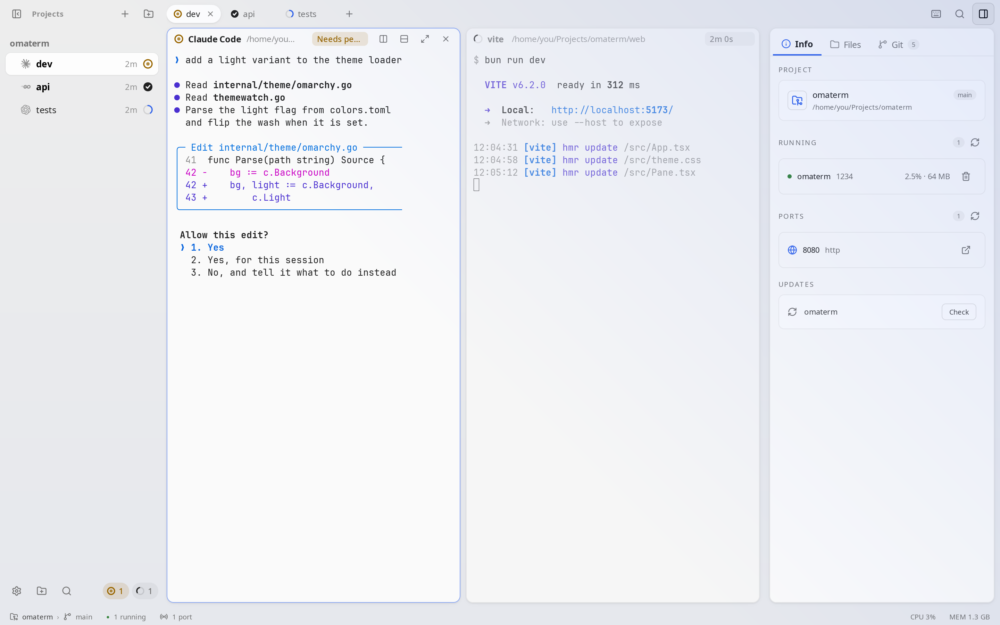

<div align="center">


# omaterm

**Oh My Terminal: a terminal workspace for running coding agents side by side.**

[](https://github.com/fachrihawari/omaterm/releases/latest)
[](LICENSE)


[Website](https://fachrihawari.github.io/omaterm/) ·
[Download](https://github.com/fachrihawari/omaterm/releases/latest) ·
[Changelog](CHANGELOG.md)

</div>



Run Claude Code, Codex, Gemini, OpenCode and Pi in split panes, in one native
window. omaterm shows you which agent needs you, what each one changed in its
last turn, and keeps your sessions running after you close the window. Git,
an editor and a browser sit next to your shells.

## Highlights

- **Agent status at a glance.** Every session shows whether it is working,
  needs you, failed or is done, and notifies you when it needs you.
- **Last turn.** See what an agent changed in its last turn, apart from your
  own uncommitted work, and keep or revert each hunk.
- **Agents on branches of their own.** Start an agent in a git worktree, so
  several work in parallel without touching each other's files. Review its
  branch, then merge it or discard it.
- **Agents that work together.** An agent splits a task between agents on
  branches made from its own, asks them and gets their answers, and merges
  their work. Another agent can review a session's work, round after round.
- **Project processes.** A project's dev server, queue worker or watcher is
  defined once, and omaterm runs it, restarts it when it fails and shows it in
  the sidebar. You and every agent share it: `omaterm start web` runs the one
  you have.
- **Sessions that keep running.** Close the window and they carry on. After a
  reboot, agents resume the same conversation.
- **On your phone.** Pair a browser with a QR code, then watch and type into
  any session.
- **Everything next to the terminal.** A Git panel, commit graph, diffs, a
  file tree, an editor and browser panes.
- **Scriptable.** The `omaterm` command lets agents and scripts open panes,
  read them, type into them and wait for them.
- **Themes that follow your desktop**, dark or light, including
  [Omarchy](https://omarchy.org)'s themes, live.

## Install

**Linux** (x86-64 and ARM64):

```sh
curl -fsSL https://github.com/fachrihawari/omaterm/releases/latest/download/install.sh | sh
```

This installs the app in `~/.local/omaterm.app` and adds it to your app
launcher. It needs no root.

**macOS** (Universal) and **Windows** (x64): download the `.dmg` or the
`Setup.exe` from the
[latest release](https://github.com/fachrihawari/omaterm/releases/latest).
A `.deb` and `.tar.gz` for Linux are there too.

omaterm updates itself: a new release shows up as an update in the app.

### First steps

1. Open a project folder from the sidebar.
2. Start an agent in a session. Its status shows in the sidebar and in the
   pane's header.
3. Accept the offer to **set up the agent integration**, or run it from the
   command palette (`Ctrl+Shift+P`). It installs a small hook and a skill
   for your agents, so a restart resumes each one's own conversation and
   agents learn the `omaterm` command.
4. To use the `omaterm` command in your own shells too, run **Install Command
   Line Tool** from the palette. It links the command into `~/.local/bin`.

## A tour

### See which agent needs you

Each session shows whether it is working, needs you, failed or is done. This
works for Claude Code, Codex, Gemini, OpenCode, Pi and any program that
reports its status. When a session needs you while you look away, you get a
notification; `Ctrl+Shift+J` jumps to it.

### What did that turn change?

In the Git tab, **Last turn** (`Ctrl+Shift+A`) lists what an agent changed in
its last turn, apart from everything else you haven't committed. Keep or
revert each hunk.



### Projects, sessions and split panes

The sidebar lists each project with its sessions, and switching projects
keeps the other one's shells running. Split a pane right (`Ctrl+Shift+R`) or
down (`Ctrl+Shift+D`), zoom one (`Ctrl+Shift+Enter`), and drag a pane's
header to move it.



### Agents on branches of their own

**New Agent in Worktree…**, in the command palette or a project's menu,
starts an agent on a new branch, in a git worktree of its own under the
repository's `.worktrees` folder, with your `.env` files copied in. Run
several at once: none touches another's files, or yours.

The Git tab follows the session into its worktree, and its **Branch** view
shows everything the branch changed since it started. From the session's
menu:

- **Merge into main…** squashes the branch into one commit, or makes a merge
  commit, then removes the worktree. A merge that would conflict isn't made.
- **Update from main** brings main's new commits in, so conflicts are
  resolved in the worktree, never in your checkout.
- **Push & Create PR** pushes the branch and opens its pull request.
- **Discard Worktree…** deletes the worktree and its branch.

Closing the session asks before it drops work that isn't in main.

### Agents working together

An agent can lead others. It starts workers in worktrees made from its own
branch, which show under its session in the sidebar, and hands each its
part with `omaterm ask`. omaterm types each message into the worker's prompt
once it is free and you aren't typing there, and the worker's answer comes
back to the lead, waking it. The lead merges each worker into its own
branch with `omaterm merge`; merging into main stays yours.

**Ask for Review…**, in a session's menu or the command palette, starts a
second agent beside it, Codex reviewing Claude Code for instance. The
reviewer reads what the session changed, changes nothing itself, and sends
the agent what to fix, for up to three rounds, then tells you its verdict.

### Project processes

A project's dev server, queue worker or watcher can be a process omaterm runs
for you. It shows in the sidebar's **Processes** group with its status:
starting, running, exited, failed, paused after too many restarts, or not
trusted yet. Start, stop or restart it from its row, or from the row's menu.
A running process with a port shows the port as a pill: click it to open the
page. Open the process to see its output in a tab.

To add one, use **Add Process…** in the command palette or a project's menu. Its suggestions come from the project's files: the `dev`, `start`,
`serve`, `watch`, `preview` and `storybook` scripts in `package.json`,
`Procfile.dev` and `Procfile`, the `dev`, `serve`, `watch` and `run` targets
of a `Makefile`, `justfile` or `Taskfile.yml`, `docker-compose.yml` or
`compose.yml`, the servers of Laravel, Rails, Django and Go projects, and a
`solo.yml`. Pick one to fill in the form, then change what you need.

A process is defined in `omaterm.yml` at the project root, which you commit
and share with your team, or locally in omaterm, which keeps it out of the
repository. The Add or Edit dialog's **Save in omaterm.yml** switch chooses
between them. It is on by default when the project is a git repository, and
**Edit…** in a process's menu opens the dialog for either kind.

```yaml
processes:
  web:
    command: pnpm run dev
    port: 5173
    autostart: true
    restart: on-failure     # never | on-failure | always
    watch: ["src/**", "package.json"]
    env:
      NODE_ENV: development
  worker:
    command: go run ./cmd/worker
    dir: services/worker
```

Each process takes:

- `command`, which your login shell runs. It is required.
- `dir`, a folder relative to the project. It must stay inside the project.
  The default is the project's root.
- `port`, the port that means the process is up. omaterm shows it as a pill,
  and the process counts as running once the port accepts connections.
  Without a port, it counts as running two seconds after it starts.
- `autostart`, which starts the process when omaterm starts, if it is trusted.
  The default is off.
- `restart`: `never` (the default), `on-failure` or `always`. A restart waits
  one second, then doubles the wait each time, up to 30 seconds. After ten
  restarts in a minute, the process pauses until you start it again.
- `watch`, a list of globs. A change to a matching file restarts the process.
  As in `.gitignore`, `*` stays within one folder and `**` crosses folders.
- `env`, variables added to the environment the process runs in.

A command from `omaterm.yml` runs only after you trust that exact definition.
Starting an untrusted process opens a sheet that shows its command, folder,
environment, port, restart and watch settings. **Trust and Start** runs it,
and omaterm keeps the trust for that definition, in that project folder, on
this machine. Renaming a process, or turning autostart on or off, keeps the
trust. Changing the command, folder, environment, port, restart or watch
settings does not. A changed definition makes a stopped process untrusted
again, and a running one shows a dot until you restart it.

Processes run in the session daemon, so they keep running after you close the
window, as sessions do. With the daemon off, or on Windows, omaterm runs them
itself, and they stop when it quits. When a process fails or its restarts are
paused, omaterm sends a desktop notification, if **Notify When a Session
Fails** is on.

From the command line, `omaterm ps` lists the project's processes with their
status, port, process ID and restarts. `omaterm start web --wait` starts one
and waits until it is up, or exits with an error if it fails. `omaterm stop`
and `omaterm restart` do what they say. Each process is a session named after
it, so `omaterm read web` shows its output and `omaterm wait web` waits on
it. Agents are taught to use these processes rather than start their own
dev server, and to ask you before they add or change one.

The idea of defining a project's processes in a committed file comes from
[Solo](https://soloterm.com) (`solo.yml`), whose files omaterm imports as
suggestions.

### Sessions keep running

Sessions run in a session daemon, so they keep going after you close the
window and are back when you open it. (Not on Windows, which has no daemon
yet: there omaterm asks before quitting ends a running agent.) After a reboot, Claude Code, Codex,
OpenCode and Pi resume the same conversation.
`omaterm daemon install-service` runs the daemon as a systemd user service,
so your sessions come back when you log in.

### Git, diffs and an editor

Stage, commit, stash, fetch, pull and push from the Git panel. There is a
commit graph, side-by-side and inline diffs (images too), a file tree, and an
editor with syntax highlighting and Markdown preview.

| Git panel | Diff |
| --- | --- |
|  |  |
| **Commit graph** | **Editor** |
|  |  |

### Your sessions, from your phone



**Web access** shows your sessions in a browser: which agents are working or
need you, and any pane as a live terminal you can type into, with a key bar
for Esc, Ctrl and the arrows on a phone.

Turn it on in Settings, or with `omaterm web on`. It serves on
`127.0.0.1:7370`; reach it through a tunnel you already trust:

```sh
tailscale serve --bg 7370                       # your tailnet only
cloudflared tunnel --url http://127.0.0.1:7370  # a public https URL
```

`omaterm web on --network` serves it on your local network instead. That is
plain HTTP, so use it only on networks you trust.

A browser sees nothing until you pair it: **Pair a Device** in Settings, or
`omaterm web pair`, shows a QR code that works once, for ten minutes. Revoke
a device in Settings or with `omaterm web revoke`.

<br clear="right">

### Browser panes

`Ctrl+Shift+O` opens a web page next to your terminals, as does
`omaterm split --url localhost:5173`. With **Let Agents Control the App** on,
agents can read, click, type into and screenshot the page with
`omaterm browser`.

### Themes, dark and light

Pick a dark or light theme, or follow your desktop's. The window, terminals
and editor share one palette, checked for contrast so text stays readable.
On [Omarchy](https://omarchy.org), omaterm follows the active theme as you
switch it.

| Tokyo Night | Lupine (light) |
| --- | --- |
|  |  |

### Settings

`Ctrl+,` opens the Settings window: theme, terminal, editor, notifications,
agents, web access and updates, with search, and changes apply as you make
them. They live in `~/.config/omaterm/settings.json`.

## The `omaterm` command

Agents and scripts drive your sessions with it:

```sh
omaterm split --down -- go test ./...   # run in a new pane below
omaterm wait <pane> --exit              # wait for it to finish
omaterm read <pane>                     # read its screen
omaterm send <pane> "y" --enter         # type into it, once you stop typing there
omaterm diff --turn                     # what the last agent turn changed
omaterm new --worktree fix-login -- claude  # an agent on a branch of its own
omaterm ask fix-login "Is the test green?"  # ask another agent, get its answer
omaterm ps                              # the project's processes and their status
omaterm start web --wait                # run one, and wait until it is up
omaterm restart web                     # restart one
omaterm stop web                        # stop one
```

`omaterm help` lists every command. `omaterm skill setup` teaches Claude
Code, Codex, Pi and OpenCode to use it. Every pane knows where it runs:
`$OMATERM_SESSION`, `$OMATERM_PANE`, `$OMATERM_PROJECT` and
`$OMATERM_PROJECT_DIR`.

## Keyboard shortcuts

| Action | Linux and Windows | macOS |
| --- | --- | --- |
| Command palette | `Ctrl+Shift+P` | `⇧⌘P` |
| Settings | `Ctrl+,` | `⌘,` |
| Go to file | `Ctrl+P` | `⌘P` |
| Search in project | `Ctrl+Shift+F` | `⇧⌘F` |
| Open a project | `Ctrl+O` | `⌘O` |
| New terminal | `Ctrl+T` | `⌘T` |
| Close the pane, or the tab | `Ctrl+W` | `⌘W` |
| Split right / down | `Ctrl+Shift+R` / `Ctrl+Shift+D` | `⇧⌘R` / `⇧⌘D` |
| Zoom pane | `Ctrl+Shift+Enter` | `⇧⌘↩` |
| Go to tab 1–9 | `Alt+1` … `Alt+9` | `⌘1` … `⌘9` |
| Go to project 1–9 | `Alt+Shift+1` … `Alt+Shift+9` | `⌥⌘1` … `⌥⌘9` |
| Next / previous session | `Alt+↓` / `Alt+↑` | `⌥↓` / `⌥↑` |
| Go to the session that needs you | `Ctrl+Shift+J` | `⇧⌘J` |
| Files / Git / Last turn / Info | `Ctrl+Shift+E` / `G` / `A` / `I` | `⇧⌘E` / `G` / `A` / `I` |
| Toggle sidebar / inspector | `Ctrl+B` / `Ctrl+Shift+B` | `⌘B` / `⇧⌘B` |
| Text size | `Ctrl+=` / `Ctrl+-` / `Ctrl+0` | `⌘=` / `⌘-` / `⌘0` |
| Save a file | `Ctrl+S` | `⌘S` |
| Open a browser pane | `Ctrl+Shift+O` | `⇧⌘O` |
| In a browser pane: address, reload, find | `Ctrl+L`, `Ctrl+R`, `Ctrl+F` | `⌘L`, `⌘R`, `⌘F` |
| In a browser pane: back / forward | `Alt+←` / `Alt+→` | `⌘[` / `⌘]` |
| All shortcuts | `Ctrl+Shift+/` | `⇧⌘/` |

On macOS, Option types characters and moves the shell's cursor by words
(`⌥←`, `⌥→`), so tabs are `⌘` digits there and projects `⌥⌘` digits.

## Building from source

omaterm is written in Go with [MyGo](https://github.com/egoist/mygo).

```sh
go test ./...    # tests
bun install      # mygo-cli, for the dev loop and packaging
bun run dev      # run with reload
bun run build    # build the app
```

`SITE_SHOTS=1 go test -run TestSiteShots .` renders the screenshots in this
README and on the website into `site/assets`. [RELEASING.md](RELEASING.md)
covers how releases are cut.

## Credits

omaterm builds on:

- **[Kero](https://github.com/egoist/kero)** by EGOIST (MIT). Much of omaterm
  is adapted from it: the session engine (control protocol, PTY, OSC status,
  git turn snapshots), the `omaterm` command with its agent hooks, plugins
  and skill, and browser panes, pane layout and elevation. Each such source
  file names the Kero file it comes from.
- **[herdr](https://github.com/herdrdev/herdr)** (Apache-2.0): the agent
  detection rules, through Kero.
- **[MyGo](https://github.com/egoist/mygo)** (MIT), the app framework, and
  **[Ghostty](https://github.com/ghostty-org/ghostty)**'s libghostty-vt
  (MIT), the terminal emulation.
- **[Lucide](https://lucide.dev)** (ISC) and Feather (MIT) for the icons, and
  **[Simple Icons](https://simpleicons.org)** (CC0) for the program logos,
  which are their owners' trademarks.

And learned from, sharing no code:
**[Rex](https://superlogical.com)** by Superlogical (card panes, pane headers,
and OSC 7501, the Program Status Protocol omaterm reads agents' status with),
**[Tern](https://stencil.so/tern)** by Stencil (how an agent terminal should
look and feel), **[Solo](https://soloterm.com)** (the idea of a project's
processes in a committed file, and its `solo.yml` format), **[OpenCode](https://opencode.ai)** (whose web mode inspired
web access) and **[Omarchy](https://omarchy.org)** (the desktop omaterm was
first made for).

License texts for these and the Go libraries omaterm uses are in
[THIRD_PARTY_NOTICES.md](THIRD_PARTY_NOTICES.md), which ships with every
release.

## License

[MIT](LICENSE)
